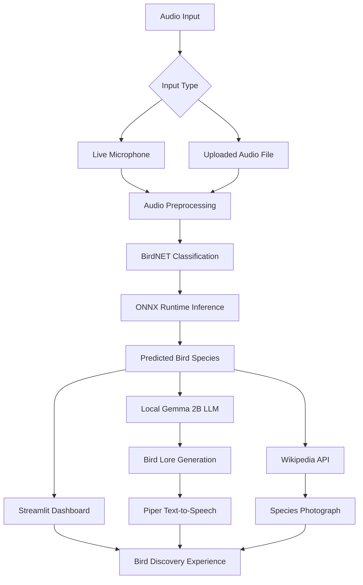

# 🐦 AvianEcho — Real-Time Edge AI Bird Guide

<p align="center">
  <strong>Listen to Nature. Discover the Birds Around You.</strong>
</p>

<p align="center">
  An AI-powered bird identification and discovery platform combining real-time audio analysis, edge machine learning, local language models, and voice-based storytelling.
</p>

<p align="center">
  
  
  
  
  
</p>

---

## 🧭 Explore AvianEcho

<p align="center">
  <a href="#-about-the-project"></a>
  <a href="#-key-features"></a>
  <a href="#-system-architecture"></a>
  <a href="#-technology-stack"></a>
  <a href="#-installation-and-setup"></a>
  <a href="#-future-enhancements"></a>
  <a href="#-contributing"></a>
</p>

---

## 📖 About the Project

**AvianEcho** is an AI-powered bird identification and exploration application that helps users discover bird species through their vocalizations.

Bird calls are one of nature's most useful identification signals, but recognizing them can be challenging without specialized knowledge. AvianEcho makes this process more accessible by combining audio classification, locally running AI models, educational content generation, and natural-sounding voice feedback.

The application analyzes live microphone input or uploaded audio recordings, identifies likely bird species through a BirdNET-based classification pipeline, and presents the results through an interactive Streamlit dashboard.

It can also generate engaging bird facts using a locally hosted Gemma 2B language model and read those facts aloud using Piper Text-to-Speech (TTS).

When an internet connection is available, AvianEcho can retrieve relevant species photographs through the Wikipedia API.

### 🎯 Our Vision

To build a practical, privacy-conscious, and resource-aware AI bird guide that makes wildlife discovery more accessible to birdwatchers, students, nature enthusiasts, and environmental educators.

---

## ❗ The Problem

Identifying birds by their calls can be difficult for people without ornithological experience.

Traditional identification methods often require users to:

- Recognize bird calls manually or consult field guides.
- Search multiple websites to identify unfamiliar sounds.
- Depend on cloud-based services that may require an internet connection.
- Read information on a screen while observing wildlife outdoors.
- Switch between separate applications for identification, photographs, and educational information.

These barriers can make bird identification less accessible, particularly during outdoor exploration or in locations with limited connectivity.

## 💡 Our Solution

AvianEcho combines bird identification and learning in one application.

1. **Capture:** Record bird calls through a microphone or upload an existing audio recording.
2. **Analyze:** Process the audio and prepare it for the classification model.
3. **Identify:** Run inference using a compatible BirdNET-based model through ONNX Runtime.
4. **Discover:** Display the predicted species and retrieve a relevant photograph when online resources are available.
5. **Learn:** Generate educational content using a locally hosted Gemma 2B language model.
6. **Listen:** Convert the generated information into speech using Piper TTS.

The core inference workflow is designed to run locally, reducing dependence on cloud-based AI inference. Optional online features, such as Wikipedia image retrieval, still require internet access.

---

## ✨ Key Features

### 🎙️ Real-Time Bird Call Detection

- Capture audio from a supported microphone.
- Analyze incoming audio using the bird classification pipeline.
- Identify likely bird species from their vocalizations.
- Support local inference without requiring a cloud inference API.

### 📁 Audio File Analysis

- Analyze previously recorded bird sounds.
- Support WAV and MP3 files when the installed audio-decoding dependencies permit.
- Load and preprocess recordings using Librosa.
- Standardize the audio representation according to the model's requirements.

### 🧠 Local AI-Powered Bird Lore

- Generate interesting facts about identified bird species.
- Use a locally hosted Gemma 2B model.
- Run language generation through `llama-cpp-python` when configured with a compatible model.
- Provide an engaging educational experience beyond the predicted species name.

*AI-generated descriptions may contain inaccuracies. Consult trusted ornithological references when scientific accuracy is essential.*

### 🗣️ Text-to-Speech with Piper

- Convert generated descriptions into spoken audio.
- Support an audio-first wildlife guide experience.
- Reduce the need to read the dashboard while observing nature.
- Use a local Piper installation and compatible voice model.

### 📸 Species Photography

- Retrieve relevant bird photographs through the Wikipedia API.
- Display representative images alongside identification results.
- Provide visual context for unfamiliar species.
- Handle missing images and network errors gracefully.

*Internet access is required for live Wikipedia image retrieval.*

### 🖥️ Interactive Streamlit Dashboard

- Access bird identification through a browser-based interface.
- Choose from the supported audio input methods.
- View classification results and related information.
- Access generated bird lore and speech output.
- Explore species photographs when online resources are available.

---

## 🔄 How It Works



### Processing Pipeline

| Stage | Component | Responsibility |
|---|---|---|
| 1 | Microphone / file upload | Receives bird-call audio |
| 2 | Librosa and NumPy | Prepares and transforms audio |
| 3 | BirdNET model | Produces bird-classification predictions |
| 4 | ONNX Runtime | Executes a compatible exported model |
| 5 | Gemma 2B | Generates educational bird lore |
| 6 | Piper TTS | Converts text into speech |
| 7 | Wikipedia API | Retrieves online species imagery |
| 8 | Streamlit | Presents results through the dashboard |

---

## 🏗️ System Architecture

AvianEcho uses a modular architecture that separates audio input, machine-learning inference, educational content generation, speech synthesis, and presentation.

### 1. Audio Processing Layer

Responsible for receiving audio and preparing it for classification.

**Technologies:** `sounddevice`, `librosa`, `numpy`

### 2. Bird Classification Layer

Responsible for identifying likely bird species from audio.

**Technologies:** BirdNET-based classification and `onnxruntime`

The model, input tensor format, audio preprocessing, output interpretation, and species-label mapping must all be compatible.

### 3. Cognitive Layer

Responsible for generating educational descriptions of detected species.

**Technologies:** Gemma 2B and `llama-cpp-python`

A compatible local model, such as a supported GGUF model when using `llama-cpp-python`, must be available.

### 4. Voice Layer

Responsible for converting generated text into spoken audio.

**Technology:** Piper TTS

A compatible Piper runtime and voice model are required.

### 5. Presentation Layer

Responsible for displaying predictions, species information, and generated content.

**Technology:** Streamlit

### 6. Online Enrichment Layer

Responsible for retrieving supplementary species photographs.

**Technology:** Wikipedia REST API

---

## 🛠️ Technology Stack

| Technology | Purpose |
|---|---|
| Python | Main application language |
| Streamlit | Interactive web dashboard |
| BirdNET | Bird sound classification |
| ONNX Runtime | Machine-learning inference |
| Librosa | Audio loading and preprocessing |
| SoundDevice | Live microphone capture |
| NumPy | Numerical audio processing |
| llama-cpp-python | Local language-model inference |
| Gemma 2B | AI-powered bird lore generation |
| Piper TTS | Local text-to-speech synthesis |
| Wikipedia REST API | Online species image retrieval |
| Git and GitHub | Version control and collaboration |

---

## 📂 Project Structure

The following is an example structure. Update it to match the actual files in your repository.

```text
avian_echo/
│
├── app.py                      # Streamlit application entry point
├── requirements.txt            # Python dependencies
├── README.md                   # Project documentation
├── .gitignore                  # Files excluded from Git
├── .env.example                # Example configuration, if needed
│
├── models/
│   ├── birdnet.onnx            # Bird classification model
│   └── gemma-2b.gguf            # Local language model
│
├── assets/
│   ├── images/                 # Optional local images
│   └── audio/                  # Optional sample recordings
│
├── piper/
│   ├── piper.exe               # Windows executable, if bundled
│   └── voices/                 # TTS voice models and configuration
│
└── src/
    ├── audio_processor.py      # Audio preprocessing, if separated
    ├── bird_classifier.py      # Classification logic, if separated
    ├── lore_generator.py       # Local LLM integration, if separated
    └── tts_engine.py           # Speech synthesis, if separated
```

> **Note:** This tree is illustrative. It does not imply that every listed file or module already exists in the repository.

---

## 💻 Prerequisites

Before installing AvianEcho, ensure that you have:

- Python compatible with the project's dependency versions.
- Git.
- `pip` and virtual environment support.
- A microphone for live audio analysis.
- At least 4 GB of available RAM as an initial minimum target; more may be necessary for multiple AI models.
- A compatible BirdNET ONNX model and corresponding species-label data.
- A compatible Gemma 2B model.
- A Piper installation and compatible voice model.
- Internet access for initial downloads and Wikipedia image retrieval.

**Python compatibility:** Python 3.14 is not supported by every version of the packages used in this project. Verify package compatibility before selecting your Python version.

---

## 🚀 Installation and Setup

### 1. Clone the Repository

Replace `YOUR_USERNAME` with your GitHub username and use the actual repository URL.

```bash
git clone https://github.com/YOUR_USERNAME/avian_echo.git
cd avian_echo
```

### 2. Create a Virtual Environment

**Windows — PowerShell**

```powershell
py -m venv .venv
.\.venv\Scripts\Activate.ps1
```

If PowerShell blocks activation, use Command Prompt:

```bat
.venv\Scripts\activate.bat
```

**Linux / macOS**

```bash
python3 -m venv .venv
source .venv/bin/activate
```

### 3. Upgrade pip

```bash
python -m pip install --upgrade pip
```

### 4. Install Dependencies

If your repository contains `requirements.txt`, install its dependencies:

```bash
pip install -r requirements.txt
```

If you are creating the environment from scratch, the following command installs common core dependencies:

```bash
pip install streamlit librosa sounddevice numpy onnxruntime requests
```

Additional setup is required for `llama-cpp-python`, Gemma, and Piper. Follow the installation instructions for the exact versions, model formats, and operating system you use.

Do not install these packages blindly over an existing pinned environment; use the versions tested with your project.

### 5. Configure the AI Models

Obtain the required model files:

- A compatible BirdNET ONNX model and species labels.
- A compatible Gemma 2B model.
- A compatible Piper voice model and its configuration files.

Place the files where your application expects them, or update the relevant paths in your configuration.

Model files may be large, so consider excluding them from Git and documenting how to download them separately.

Always review model licenses and redistribution terms before publishing or bundling model assets.

### 6. Run the Application

If your Streamlit entry point is `app.py`, run:

```bash
streamlit run app.py
```

Open the local URL printed in the terminal.

If your entry point has a different filename, replace `app.py` with the appropriate path.

---

## ⚙️ Model and Asset Configuration

Your application must be able to locate the model files and runtime resources.

For example, your code might use:

```python
BIRD_MODEL_PATH = "models/birdnet.onnx"
GEMMA_MODEL_PATH = "models/gemma-2b.gguf"
PIPER_EXECUTABLE_PATH = "piper/piper.exe"
PIPER_VOICE_PATH = "piper/voices/en_US-voice.onnx"
```

These are example paths. Use the actual paths and filenames supported by your implementation.

### BirdNET Model

Verify the following:

- Expected audio sample rate.
- Audio window length and preprocessing.
- Input tensor dimensions and data type.
- Output interpretation and confidence thresholds.
- Species-label ordering and model version.

### Gemma 2B

Verify that:

- The model format is supported by your inference library.
- The model fits within available memory.
- The model loads successfully before lore generation.
- Prompts use the detected species and relevant verified information.

### Piper TTS

Verify that:

- The Piper executable or package is installed.
- The selected voice model is compatible with the runtime.
- Required model configuration files are available.
- The application can execute Piper and play the generated audio.

### Wikipedia API

Image retrieval should handle:

- Missing species pages.
- Unavailable thumbnails.
- Network errors and timeouts.
- API rate limits.
- Variations in species names.

---

## ▶️ Using AvianEcho

After installation and model configuration:

1. Activate the Python virtual environment.
2. Launch the Streamlit application.
3. Grant microphone permission if using live audio.
4. Choose a supported audio input method.
5. Provide a recording or start microphone capture.
6. Review the predicted species and classification results.
7. Generate or view bird lore using the local language model.
8. Play the spoken description through Piper TTS.
9. View a representative photograph if internet access and a suitable image are available.

For reliable evaluation, test the application with known recordings and compare predictions against verified species labels.

---

## 🔌 Offline Capabilities

AvianEcho is designed around local AI inference, but some features require online resources.

| Feature | Offline availability |
|---|---|
| Bird classification | Yes, after model and runtime setup |
| Audio preprocessing | Yes |
| Local Gemma lore generation | Yes, after model setup |
| Piper speech synthesis | Yes, after voice setup |
| Wikipedia photographs | No, requires internet |
| Initial model and dependency downloads | Usually requires internet |

The core workflow can operate offline once all required local assets are installed. Online enrichment features should fail gracefully when the network is unavailable.

---

## ⚡ Performance and Optimization

Running multiple AI components locally requires careful resource management.

Potential optimizations include:

- **ONNX Runtime:** Choose an appropriate execution provider for the target hardware.
- **Audio processing:** Use appropriate audio windows and avoid unnecessarily large buffers.
- **Model loading:** Reuse initialized models rather than loading them for every prediction.
- **Streamlit caching:** Cache expensive resources such as model instances where appropriate.
- **LLM quantization:** Use a compatible quantized model when memory constraints require it.
- **Lazy loading:** Initialize the language model or TTS engine only when needed.
- **Resource management:** Release microphone streams and other hardware resources when scanning stops.
- **Error handling:** Handle unavailable microphones, invalid audio, missing models, and failed API requests.

Actual speed and memory requirements should be measured on the target hardware.

---

## 🐛 Troubleshooting

### Microphone Is Not Detected

- Check operating-system microphone permissions.
- Confirm that the correct input device is selected.
- Check whether another application is using the microphone.
- Test `sounddevice` independently to verify device access.

### Bird Classification Returns Unexpected Results

- Use a clear recording with minimal background noise.
- Confirm the sample rate and preprocessing requirements.
- Verify that the ONNX model and species labels match.
- Test several known recordings before evaluating field performance.

### ONNX Runtime Cannot Load the Model

- Confirm that the model is a valid ONNX file.
- Check compatibility with your ONNX Runtime version.
- Verify the model path and input tensor dimensions.
- Install the appropriate runtime package for your platform.

### Gemma Fails to Load

- Check the model path and file format.
- Verify compatibility with your `llama-cpp-python` version.
- Check available RAM and GPU requirements.
- Follow the installation instructions for your particular model.

### Piper Does Not Generate Speech

- Check the executable and voice-model paths.
- Verify that the voice model and configuration are compatible.
- Confirm that the application has permission to execute Piper.
- Inspect process output for missing dependencies or invalid arguments.

### Wikipedia Images Do Not Appear

- Check internet connectivity.
- Confirm that the API response includes a usable thumbnail.
- Handle species-name variations and missing pages.
- Provide a fallback when an image cannot be retrieved.

### Python Package Installation Fails

- Verify that your Python version is supported by the selected package versions.
- Use a clean virtual environment.
- Check platform-specific installation requirements for compiled packages.
- Consult the official documentation for the affected dependency.

---

## 🛣️ Future Enhancements

Potential improvements for AvianEcho include:

- [ ] Audio waveform and spectrogram visualization.
- [ ] Multiple candidate species with confidence scores.
- [ ] Detection history and timestamped observations.
- [ ] A local bird-observation journal.
- [ ] GPS-based location and habitat context.
- [ ] A map of bird sightings and observation locations.
- [ ] Improved noise handling and confidence-based filtering.
- [ ] Multilingual bird lore and speech.
- [ ] Energy-efficient continuous monitoring.
- [ ] Model accuracy evaluation using labeled test datasets.
- [ ] Improved accessibility and mobile-friendly layouts.
- [ ] Automated tests for preprocessing and inference.
- [ ] Simplified installation for supported devices.

These items represent possible future work, not features that are necessarily implemented today.

---

## 🤝 Contributing

Contributions, bug reports, and suggestions are welcome!

### How to Contribute

1. Fork the repository.
2. Create a feature branch:

   ```bash
   git checkout -b feature/your-feature-name
   ```

3. Implement your changes and test them locally.
4. Commit your changes:

   ```bash
   git add .
   git commit -m "Add: describe your changes"
   ```

5. Push your branch:

   ```bash
   git push origin feature/your-feature-name
   ```

6. Open a pull request with a clear explanation of your changes.

### Contribution Ideas

- Improve audio preprocessing.
- Add model compatibility checks.
- Enhance the Streamlit interface.
- Improve offline error handling.
- Add test recordings and evaluation tools.
- Improve documentation and installation instructions.

Please do not commit API secrets, private recordings, large model files, or sensitive configuration data.

---

## 🙌 Acknowledgements

AvianEcho builds on the work of the open-source and research communities behind its component technologies.

- [BirdNET](https://birdnet.cornell.edu/) — Bird sound identification research and tooling.
- [ONNX Runtime](https://onnxruntime.ai/) — Cross-platform machine-learning inference.
- [Streamlit](https://streamlit.io/) — Python-based interactive applications.
- [Librosa](https://librosa.org/) — Audio and music signal analysis.
- [Gemma](https://ai.google.dev/gemma) — Model family for generative AI applications.
- [llama.cpp](https://github.com/ggml-org/llama.cpp) — Efficient local language-model inference.
- [Piper TTS](https://github.com/OHF-Voice/piper1-gpl) — Local neural text-to-speech.
- [Wikipedia](https://www.wikipedia.org/) — Reference information and image discovery.

Review the licensing terms of each component and model before redistribution.

---

## 📄 License

Choose an appropriate license for your project and add a `LICENSE` file to the repository.

If you intend to publish AvianEcho as an open-source project, ensure that your chosen license is compatible with your dependencies and model assets.

---

## 🌍 Built for Nature. Powered by AI.

AvianEcho brings together birdsong, edge computing, and AI-powered storytelling to make wildlife discovery more accessible.

**Listen closely. Discover more. Connect with nature.**

<p align="center">
  <strong>🐦 AvianEcho — Every Bird Has a Story.</strong>
</p>

<br>

<p align="center">
  <b>Made with ❤️ by Satwik Pagi</b>
</p>

<p align="center">
  <i>Building Edge AI & Full-Stack Solutions</i>
</p>
